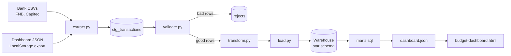
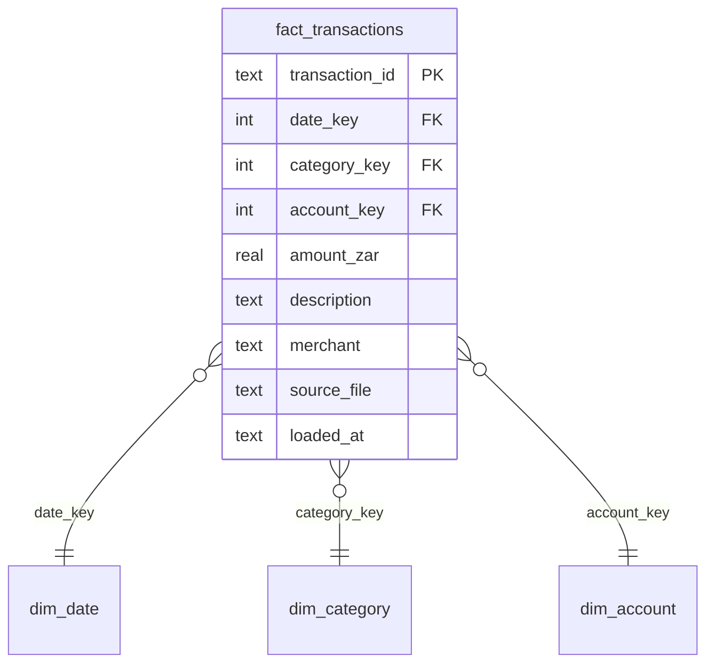

# Budget Pipeline

A batch data pipeline that turns messy bank-statement exports into a clean, modelled warehouse, then serves budget insights to a dashboard.

> Built for my Data Engineering elective. It evolves my portfolio's Budget Dashboard (a front-end demo backed by LocalStorage) into a proper **extract → validate → transform → load → serve** pipeline.

**Submission code:** `WTC-ZJG2A7V6`

[](https://github.com/ofentsechiloane/Budget-Dashboard/actions/workflows/ci.yml)


---

## Problem statement

The original Budget Dashboard kept everything in the browser's LocalStorage. That caused five problems:

| Problem | Consequence |
|---|---|
| No source of truth | Clearing the browser cleared the data |
| No real data | Transactions were typed by hand; nothing could be imported from a bank |
| No validation | Bad dates, empty amounts and duplicates went straight in |
| No history | No way to compare months or track budget vs actual |
| Inconsistent sources | Each bank exports differently (date formats, signed amounts vs separate In/Out columns) |

## Solution

A pipeline that ingests files from several sources and produces trustworthy, analysis-ready data:

1. **Extract** transactions from multiple CSV formats and the dashboard's JSON export into one uniform shape.
2. **Validate** every row. Failures are quarantined in a `rejects` table with a reason, so nothing is silently lost.
3. **Transform** by cleaning descriptions, extracting merchants, auto-categorising, and deduplicating with deterministic IDs.
4. **Load** into a SQLite star schema. Loads are idempotent: re-running never creates duplicates.
5. **Model** SQL marts for monthly spend, budget vs actual, top merchants and month-over-month change.
6. **Serve** the marts as JSON that the dashboard reads instead of LocalStorage.

**Good fit:** periodic statement exports, multiple banks or accounts, repeatable runs, budget vs actual reporting without spreadsheets.
**Not a fit:** real-time or streaming data, multi-user production systems, very large datasets.

---

## Tech tools

| Layer | Tool | Used for |
|---|---|---|
| Language | Python 3.12+ | Pipeline code (extract, validate, transform, load, orchestrate) |
| Data processing | pandas | Reading CSV/JSON and cleaning, validating and deduplicating rows |
| Warehouse | SQLite | Staging, star schema, rejects and run log |
| Modelling | SQL | Analytical marts (`marts.sql`) and warehouse schema (`schema.sql`) |
| Dashboard | HTML, CSS, JavaScript | Front end that reads the pipeline's `dashboard.json` |
| Testing | pytest | 14 tests across validation, transforms, idempotency and marts |
| CI/CD | GitHub Actions | Tests, pipeline run, idempotency check, deploy |
| Hosting | GitHub Pages | Live dashboard |
| Automation | Make, cron / Task Scheduler | Shortcuts and scheduled runs |

---

## Links

| | |
|---|---|
| Live dashboard | https://ofentsechiloane.github.io/Budget-Dashboard/ |
| Repository | https://github.com/ofentsechiloane/Budget-Dashboard |
| CI runs | https://github.com/ofentsechiloane/Budget-Dashboard/actions |
| Author | https://www.linkedin.com/in/ofentse-chiloane |

---

## Architecture



`run_pipeline.py` orchestrates every stage in order and records each run in `pipeline_runs`.

---

## Quick start

You need Python 3.12+ and Git.

**macOS / Linux**

```bash
git clone https://github.com/ofentsechiloane/Budget-Dashboard.git
cd Budget-Dashboard
python3 -m venv .venv && source .venv/bin/activate
pip install -r requirements.txt

python src/generate_sample.py                   # create synthetic demo data
python src/run_pipeline.py --input data/sample  # run the pipeline
pytest                                          # run the tests
cd dashboard && python3 -m http.server 8000     # open http://localhost:8000/budget-dashboard.html
```

**Windows (PowerShell)**

```powershell
git clone https://github.com/ofentsechiloane/Budget-Dashboard.git
cd Budget-Dashboard
python -m venv .venv
.\.venv\Scripts\Activate.ps1
pip install -r requirements.txt

python src\generate_sample.py
python src\run_pipeline.py --input data\sample
python -m pytest -q
cd dashboard; python -m http.server 8000
```

If PowerShell blocks `Activate.ps1`, run `Set-ExecutionPolicy -Scope CurrentUser RemoteSigned` once and retry.

**Makefile shortcuts** (macOS / Linux): `make setup`, `make sample`, `make run`, `make reset`, `make test`, `make check`, `make serve`, `make all`.

> The dashboard reads `dashboard/data/dashboard.json`, which the pipeline generates. Run the pipeline before serving the dashboard locally.

---

## Pipeline stages

### 1. Extract (`extract.py`)

Detects each file by its name prefix and parses it into common columns: date, amount, description, account, bank, source file and row number. **Sign convention: negative = spend, positive = income.**

| Source | Format handled |
|---|---|
| FNB CSV | `YYYY/MM/DD` dates, one signed amount column |
| Capitec CSV | `DD/MM/YYYY` dates, separate Money In / Money Out columns |
| Dashboard JSON | LocalStorage export; spend stored as positive; category taken from the envelope name |

Unparseable dates and amounts become empty values here. Judging them is the validator's job.

### 2. Stage

The raw extract is written to `stg_transactions` exactly as received and replaced on each run.

### 3. Validate (`validate.py`)

| Check | Reject reason |
|---|---|
| Description present | `missing description` |
| Date parses | `invalid date` |
| Date not in the future | `future date` |
| Amount is numeric | `invalid amount` |
| Amount is not zero | `zero amount` |

Rejected rows are stored in `rejects` with the source file, row number and reason.

### 4. Transform (`transform.py`)

- Collapse whitespace and strip card prefixes (`POS PURCHASE`, `DEBIT ORDER`)
- Extract a clean merchant name (`POS PURCHASE SHOPRITE 4411` becomes `Shoprite`)
- Categorise using whole-word keyword matching from `config.py`. The dashboard export's own category wins. Unmatched income becomes `Other Income`; unmatched spend becomes `Uncategorised`.
- Build `transaction_id` as a hash of date + amount + description + account
- Drop duplicates by `transaction_id`

### 5. Load (`load.py`)

Upserts the dimensions, then inserts facts with `INSERT OR IGNORE`, so a second run inserts 0 rows.

### 6. Marts (`marts.sql`, `marts.py`)

| Mart | Answers |
|---|---|
| `mart_monthly_spend` | How much did I spend per category each month? |
| `mart_monthly_income` | What came in each month? |
| `mart_budget_vs_actual` | Budget, actual, variance and % used per category |
| `mart_top_merchants` | Where does my money go? |
| `mart_mom_change` | How did total spend change vs the previous month? |

`marts.py` exports each mart plus a combined `dashboard.json` to `dashboard/data/`.

### 7. Orchestrate (`run_pipeline.py`)

Runs all stages, logs counts for rows read, rejected, deduplicated and inserted, and writes the run to `pipeline_runs` as success or failed (with the error).

| Flag | Purpose |
|---|---|
| `--input` | Folder of source files |
| `--reset` | Rebuild the warehouse from scratch |
| `--db` | Warehouse path |
| `--out` | Output folder for dashboard JSON |

---

## Data model



Supporting tables: `stg_transactions` (raw staging), `rejects` (quarantined rows) and `pipeline_runs` (run audit log). `amount_zar` is negative for spend and positive for income.

---

## Design decisions

| Decision | Reason |
|---|---|
| Staging before the warehouse | Raw data is kept as received, so rules can change and data can be reprocessed |
| Reject, don't drop | Bad rows are stored with a reason, so data loss is visible and fixable |
| Deterministic transaction IDs | Hashing date + amount + description + account makes loads idempotent and removes overlap between statements |
| Star schema | Simple joins and fast aggregation for budget analysis |
| Plain SQL for marts | Business logic stays readable, testable and portable to Postgres |
| Run log (`pipeline_runs`) | Every run records status and row counts, so failures and volumes can be audited |
| SQLite | Zero setup; anyone can clone and run it in a minute |

---

## Testing and CI

`pytest` runs 14 tests covering:

- Validation rules
- Categorisation and merchant cleaning
- Deterministic IDs and deduplication
- Source extraction
- End-to-end idempotency
- Failed-run logging
- Mart exports and the dashboard JSON shape
- Reconciliation: dashboard spend matches warehouse spend

GitHub Actions (`.github/workflows/ci.yml`) runs on every push and pull request:

1. Syntax check and tests
2. Builds the warehouse from sample data
3. Confirms a second run inserts 0 rows (idempotency check)
4. Uploads the generated dashboard data
5. Deploys the dashboard to GitHub Pages (pushes to `main` only)

## Deployment

The dashboard is deployed by the CI workflow, not from a branch folder. In the repo go to **Settings → Pages → Build and deployment → Source** and choose **GitHub Actions**. Otherwise GitHub serves the README instead of the dashboard.

---

## Results on sample data

| Metric | Value |
|---|---|
| Rows read | 181 |
| Rejected (all failure types covered) | 6 |
| Duplicates dropped | 2 |
| Loaded into the warehouse | 173 |
| Rows inserted on a second run | 0 |

## Using your own data

1. Put your statements in `data/raw/` (git-ignored).
2. Name them with the bank prefix: `fnb_*.csv`, `capitec_*.csv`.
3. Run `python src/run_pipeline.py --input data/raw`.

**Scheduling (daily at 06:00):**

```cron
0 6 * * * cd /path/to/Budget-Dashboard && .venv/bin/python src/run_pipeline.py --input data/raw >> logs/cron.log 2>&1
```

On Windows, use Task Scheduler to run `.venv\Scripts\python.exe src\run_pipeline.py --input data\raw` from the project folder.

**Privacy:** only synthetic data is committed. Real statements never leave `data/raw/`.

---

## Limitations and next steps

**Limitations**

- Batch only; no streaming ingestion
- Rule-based (keyword) categorisation, not ML
- Hash-based dedupe collapses two genuinely identical purchases on the same day into one
- Single user, local SQLite warehouse

**Possible extensions:** Postgres, an Airflow DAG, an S3 landing zone, incremental loads with a date watermark.

---

## Project structure

```
Budget-Dashboard/
├── .github/workflows/ci.yml   # Tests, pipeline run, idempotency check, Pages deploy
├── data/
│   ├── raw/                   # Your real source files (git-ignored)
│   └── sample/                # Synthetic bank exports for demo and tests
├── src/
│   ├── config.py              # Paths, category rules, budgets
│   ├── generate_sample.py     # Synthetic data generator (includes dirty rows)
│   ├── extract.py             # Read CSV / JSON sources into one DataFrame
│   ├── validate.py            # Data quality checks, route bad rows to rejects
│   ├── transform.py           # Clean, categorise, deduplicate
│   ├── load.py                # Idempotent load into the warehouse
│   ├── marts.py               # Build marts and export JSON
│   └── run_pipeline.py        # Runs every stage in order, with logging
├── sql/
│   ├── schema.sql             # Warehouse tables
│   └── marts.sql              # Analytical views
├── dashboard/
│   ├── budget-dashboard.html
│   └── data/                  # Generated pipeline output (git-ignored)
├── tests/
│   ├── test_pipeline.py       # Validation, transforms, extract, idempotency, failed runs
│   └── test_marts.py          # Mart exports, dashboard JSON shape, reconciliation
├── Makefile
├── pytest.ini
├── requirements.txt
└── README.md
```

---

## Author

**Ofentse Chiloane**, 
[GitHub](https://github.com/ofentsechiloane) · 